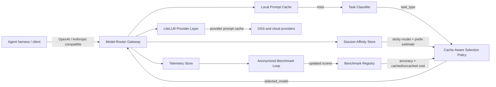

# Model-Router Architecture

## Vision

An **intelligence-aware, cache-aware inference router** that selects the best open-source (or low-cost) model for each task using benchmarks — minimizing **$/task completion** without sacrificing task accuracy, intelligence, or E2E/turn latency.

**Primary customers:** high-volume multi-task inference users, especially agent harness owners (Warp, open-code, Robusta, Hermes, etc.).

**North-star metric:** reduce $/task completion vs always routing to a frontier (or oversized) model — counting **prompt-cache savings**, not just list $/token.

**Initial intelligence seed:** public scores from **DeepSWE**, **SWE-bench Verified**, **Terminal-Bench v2.1**, **Artificial Analysis Intelligence Index**, and **Arena AI** — see [BENCHMARKS.md](BENCHMARKS.md).

---

## Design principles

1. **Intelligence floor, then effective cost** — never pick a cheaper model that fails the task-type accuracy threshold; cost includes cached-token rates and session cache state.
2. **Latency budget** — classification + selection + cache lookup must add negligible overhead (target: p99 < 20–50ms for heuristic path; optional async/LLM classify only when needed).
3. **Drop-in compatibility** — OpenAI- and Anthropic-compatible APIs so harnesses change little more than `base_url` + API key.
4. **LiteLLM as the provider fabric** — Model-Router owns *which* model; LiteLLM owns *how* to call it.
5. **Benchmarks are the product** — static seed data first; continuous anonymized interaction feedback later.
6. **Cache stickiness beats naive re-routing** — flipping models mid-session can destroy provider prompt-cache hits; the router prices that tradeoff explicitly.

---

## System overview



### Request path (happy path)

1. Client sends `POST /v1/chat/completions` (or Anthropic-compatible equivalent), ideally with `X-Session-Id`.
2. **Local prompt cache** checks exact (and later prefix) keys; on hit, return immediately.
3. Gateway extracts messages / tools / system hints.
4. **Classifier** returns `task_type` (+ confidence).
5. **Cache-aware selection policy** reads benchmarks + session affinity and picks the model with lowest **effective** $/request among those meeting the intelligence floor — pricing cached vs cold tokens and preferring stickiness when it wins.
6. Gateway rewrites `model`, enables provider cache hints when supported, and calls LiteLLM.
7. Response returns to client; affinity + local cache updated; **telemetry** records tokens, $, cache layer/hit, classification, Δ$ vs frontier.

---

## Core components

### 1. Gateway

- Local process today; same binary shape later for cloud (stateless replicas behind a load balancer).
- Exposes OpenAI Chat Completions; Anthropic Messages can follow (LiteLLM already normalizes both).
- Accepts a logical model id such as `model-router/auto` so clients do not hard-code a backend model.
- Pass-through for explicit model names when the client opts out of auto-routing (`model-router/passthrough` or direct provider model ids).

### 2. Task classifier

Identifies **task type** for the current turn / session.

| Phase | Approach | Latency |
| --- | --- | --- |
| MVP | Heuristic rules + keyword/tool signals (code, SQL, summarization, RAG QA, planning, chat, …) | < 5ms |
| Next | Tiny local classifier (e.g. RouteLLM-style / small embedder) | tens of ms |
| Later | Session-aware classifier (multi-turn task drift) | cached per session |

**Initial task taxonomy (MVP):**

- `code_generation`
- `code_review_debug`
- `reasoning_math`
- `summarization`
- `extraction_qa`
- `tool_use_agent`
- `creative_writing`
- `general_chat`

Confidence below a threshold → fall back to a safe default model (still cheaper than frontier when possible).

### 3. Benchmark registry

Per `(model_id, task_type)`:

| Field | Meaning |
| --- | --- |
| `accuracy` | Task completion / intelligence score in `[0, 1]` |
| `input_cost_per_m` / `output_cost_per_m` | $/1M tokens (uncached) |
| `cached_input_cost_per_m` | $/1M **cached** input tokens (provider prompt cache) |
| `supports_prompt_caching` | Whether provider prompt caching is usable for this model |
| `p50_latency_ms` (optional) | Soft constraint |
| `context_window` | Hard filter when prompt is large |
| `source` | `seed` \| `eval_suite` \| `online` |
| `updated_at` | Freshness |

MVP: YAML/JSON seed file sourced from public leaderboards ([BENCHMARKS.md](BENCHMARKS.md)). Later: SQLite/Postgres + online updates from anonymized outcomes.

**Intelligence floor:** policy config `min_accuracy_by_task` (global default + per-task overrides). Operator can tighten floors for agent harness SLAs.

### 4. Selection policy (cache-aware)

```text
candidates = models available AND context_window OK
eligible   = candidates WHERE accuracy[task] >= min_accuracy[task]

effective_cost(model) =
  cached_tokens * cached_input_price(model)
  + uncached_tokens * input_price(model)
  + estimated_output_tokens * output_price(model)

# Session stickiness: only the sticky model gets cached_tokens > 0
# (switching models cold-starts provider prompt cache)

if sticky_model in eligible:
  prefer sticky unless another eligible model is cheaper after full cold cost
     by more than switch_savings_margin
else:
  pick argmin effective_cost(eligible)
  # when prefix reuse is likely (tools / long system / multi-turn),
  # break ties toward supports_prompt_caching=true
```

Optional knobs (post-MVP):

- Soft latency penalty
- Preference for already-warm / co-located deployments
- Exploration rate for continuous benchmarking (ε-greedy)
- Learned prefix-token estimators per harness

### 5. Prompt caching layer

Two cooperating caches — both are in scope:

| Layer | What it caches | Why |
| --- | --- | --- |
| **Local prompt cache** | Exact (MVP) / prefix (later) request → response | Avoid provider round-trip for identical agent retries / fan-out |
| **Provider prompt cache** | Stable prompt prefix at the model host (OpenAI/Anthropic/etc.) | Cut $/token and TTFT on multi-turn agent loops |

**Cache-aware router behaviors:**

1. **Session affinity** — `X-Session-Id` binds subsequent turns to the selected model while it remains intelligence-eligible, unless a switch clearly wins on effective $.
2. **Cache-priced ranking** — use `cached_input_cost_per_m` for the sticky model’s estimated reusable prefix; cold models priced at full input rates.
3. **Provider cache enablement** — pass through / set cache-control hints via LiteLLM when the selected model supports it.
4. **Local exact cache** — keyed by hash(model, messages, tools, temperature, …); short TTL; bypass when `stream` or `temperature` implies non-determinism (configurable).
5. **Telemetry** — `cache_hit`, `cache_layer` (`local` \| `provider_affinity` \| `none`), estimated cached tokens, estimated $ saved.

### 6. LiteLLM provider layer

- All provider credentials and model aliases live in LiteLLM-style config.
- Model-Router never reimplements provider SDKs.
- Enables OpenAI + Anthropic surface compatibility and dozens of OSS backends (Together, Fireworks, Groq, vLLM, Ollama, etc.).

### 7. Telemetry

Per request / session:

- Session id, request id, wall time
- Task classification + confidence
- Selected model, eligible set size, policy reason
- Prompt / completion tokens, computed $
- Δ$ vs configured frontier baseline model
- Cache hit/miss, cache layer, affinity model id
- Success / error; optional harness “tick” / accuracy signal when provided

MVP: structured JSONL logs. Later: OpenTelemetry + metrics backend; LiteLLM’s built-in cost fields where available.

### 8. Continuous benchmarking (post-MVP)

- Anonymize prompts (hash / redact PII; store features not raw text by default).
- When harnesses report task success/failure (or implicit signals: retries, tool errors, user undo), update online accuracy estimates with Bayesian / EWMA smoothing.
- Never train on or retain raw customer content without explicit opt-in.
- Track observed cache hit rates to improve prefix estimates.

---

## API surface

| Endpoint | Role |
| --- | --- |
| `POST /v1/chat/completions` | OpenAI-compatible; `model: model-router/auto` triggers intelligence routing |
| `GET /health` | Liveness |
| `GET /v1/router/explain` (debug) | Dry-run: classification + selected model without calling a provider |
| `POST /v1/messages` | Anthropic-compatible (phase 2) |

Clients point `OPENAI_BASE_URL` / SDK `base_url` at the gateway.

---

## Deployment shapes

| Mode | Description |
| --- | --- |
| **Local** | Single process: FastAPI gateway + classifier + policy + LiteLLM completions |
| **Cloud gateway** | Same app, horizontally scaled; shared benchmark store; secrets via env |
| **Sidecar** | Optional later: router next to harness for minimal RTT |

No separate “control plane” in MVP — config files + env vars.

---

## Integration with harnesses

1. Set base URL to Model-Router; use `model-router/auto`.
2. Optionally send `X-Session-Id` and harness metadata (`X-Harness: open-code`).
3. Optionally POST outcome ticks to a feedback endpoint (phase 2) for online benchmarks.
4. Pluggable adapters documented for Hermes / open-code / similar (thin config, not forks).

---

## MVP vs later

### MVP (this repo scaffold)

- Python FastAPI gateway on LiteLLM completions
- Heuristic task classifier
- Seeded benchmark YAML + cost/accuracy selection policy
- **Cache-aware routing:** session affinity, cached-token cost pricing, local exact prompt cache
- OpenAI-compatible `/v1/chat/completions`
- JSONL telemetry + frontier cost delta + cache metrics
- Dry-run explain endpoint
- Local run via `uvicorn` + `.env`

### Explicitly out of MVP

- Production cloud multi-tenant auth / billing
- Full Anthropic Messages parity
- Online continuous benchmark learning
- Learned tiny classifier
- Semantic / fuzzy local prompt cache
- Native plugins into every harness codebase
- Weighted LiteLLM routing plugins (can adopt later if we move selection into LiteLLM Proxy)

---

## Why not “only LiteLLM Proxy routing”?

LiteLLM already offers load balancing, cost-based routing, complexity auto-router, and routing plugins. Those optimize **deployment health / cost among equivalents**, not **task-intelligence floors from our benchmark product**.

Model-Router sits **above** LiteLLM:

- We own taxonomy, intelligence scores, and $/task policy.
- LiteLLM owns provider I/O, retries, and cost accounting helpers.

We can later expose our policy as a LiteLLM `CustomRoutingStrategy` / routing plugin if we want a pure-proxy deployment; the domain logic stays the same.

---

## Repository layout (target)

```text
docs/ARCHITECTURE.md          # this document
Model router requirements.md  # product requirements
README.md
pyproject.toml
.env.example
config/
  models.yaml                 # LiteLLM-facing model deployments
  benchmarks.yaml             # cost + accuracy by task (+ cache rates)
  policy.yaml                 # intelligence floors, frontier, cache knobs
src/model_router/
  gateway.py                  # FastAPI app
  classifier.py
  policy.py                   # cache-aware selection
  prompt_cache.py             # local cache + session affinity
  telemetry.py
  litellm_backend.py
  config.py
tests/
```

---

## Success criteria (MVP demo)

1. Client calls `model-router/auto` with a coding prompt → router selects a strong code model, not the cheapest chat model.
2. Simple chat prompt → cheaper model that still clears the chat accuracy floor.
3. Telemetry line shows classification, selected model, cost, and Δ$ vs frontier.
4. `/v1/router/explain` shows the decision without spending tokens.
5. Classification + selection overhead stays well under typical network RTT to providers.
6. Same `X-Session-Id` on turn 2 sticks to the prior model when still eligible (provider cache affinity).
7. Identical retry hits the **local** prompt cache and skips the provider.
